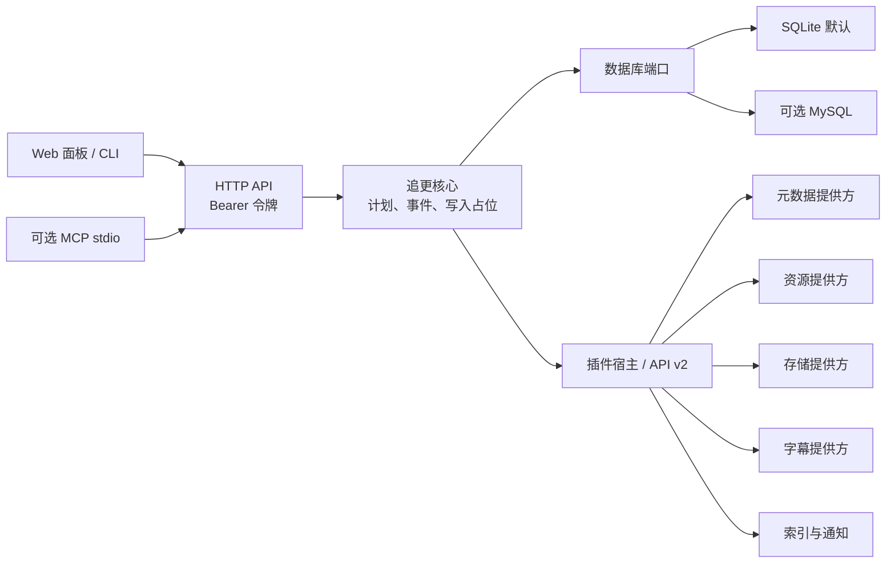

# drama-warden

> **Rust migration:** the `rust-backend` branch contains the initial Rust service and language-neutral plugin protocol. It is not yet feature-compatible with the Node.js service on `main`; keep production data and automatic writes on the existing deployment until API and workflow parity is complete.

**追剧引擎**：面向家庭媒体库的追更与归档自动化项目。

项目会把经过长期使用验证的追更流程整理成独立、可配置、可扩展的开源应用。核心负责节目、季、集和追更状态；外部元数据、资源搜索、网盘存储、索引和通知通过插件接入。

## 使用范围与免责声明

本项目仅面向个人学习和家庭自托管场景。部分网盘 provider 可能依赖非官方接口或第三方命令行工具；接口和服务规则可能变化，自动化访问可能导致服务中断、数据风险或账号受限。使用者须自行确认服务商规则、所在地适用要求以及所处理媒体内容的授权和权利，并对账号配置、自动化操作和使用后果负责。本项目不提供媒体内容，也不保证第三方服务持续可用。

## 当前状态

本项目仍在持续开发中。当前版本初始化 SQLite 数据库，包含节目、季集、资产、追更事件和插件调用审计仓库，并提供元数据回退服务、单分享追更预览/排队及单个事件的存储处理 API。处理会复核分享文件、确认本次新增文件集合、规范季目录和文件名、同步资产，并在配置索引插件时刷新索引。进程中断或写入结果不确定时，可通过受保护的事件复核 API 检查已保存文件，或确认无输出后显式开放安全重试；它不会自动再次保存分享文件。

字幕链路已有 provider 契约、持久化任务队列、独立 worker 和受保护 API。OpenSubtitles 在配置 API key 后启用；Assrt 网页搜索需手动打开。任务要求已扫描到唯一视频资产，并只写入具备可选 `writeSidecar` 能力的存储插件。本地存储已支持字幕旁路文件；夸克和 115 目前不能作为字幕写入目标。写入结果不确定时任务会进入人工核对状态，不自动重写。

SQLite 是默认数据库。可选 MySQL 驱动、v4 schema 和 SQL 方言路径已加入；MySQL 8.4 集成测试覆盖迁移、重复启动、资产扫描、字幕任务，以及通过模拟存储/索引插件执行完整追更流程和写入失败恢复。SQLite 与 MySQL 的合成数据备份恢复演练已通过；真实媒体/授权恢复与供应商 I/O 仍待验收。配置方式见 [数据库说明](docs/DATABASES.md)。

资源搜索插件契约、只读本地候选搜索、候选预览 API 与可选周期调度已接入。Docker Compose 默认启用本地文件系统存储和只读本地资源搜索；其他资源来源可通过 `resource-provider` 插件接入，核心会把目标存储类型传给插件，并在追更预览中复核候选。TVmaze 元数据插件默认启用，TMDB 可选；镜像内置夸克和 115 存储适配器。配置 `FEISHU_WEBHOOK_URL` 后会启用内置飞书通知插件，向已完成、跳过或失败的追更事件发送卡片。周期调度默认关闭；可在设置页启用并设置间隔。定时扫描会搜索并排队候选，媒体自动转存还需额外开启自动处理开关。手动扫描只返回不排队、不转存的候选预览，处理也可通过 `POST /api/events/:id/process` 手动触发。

## 设计目标

- 元数据提供方可替换，TMDB 和 TVmaze 不决定节目内部主键或文件 canonical 名称。
- 资源搜索、存储、索引、通知和字幕能力通过有版本的插件契约接入。
- 追更工作流掌握缺集判断和状态转换；插件只执行声明的外部能力。
- 默认使用 SQLite，MySQL 作为可选数据库。
- MCP 集成通过可选 stdio 进程提供，基础 Web 服务不依赖特定 agent 或 MCP SDK。
- 涉及网盘写入的操作可审计；不根据同一集号推断文件内容相同。

## 主要功能

- 按季、集管理节目进度和媒体资产，明确记录缺集、重复版本及冲突。
- 预览分享内容后再排队；处理时核对文件清单、目标目录和写入占位，避免不确定写入自动重试；中断后可显式复核。
- 通过插件接入元数据、资源搜索、网盘存储、字幕、索引和通知；内置只读本地资源搜索与本地文件系统存储。
- 使用 SQLite 单文件运行；需要时可切换到可选 MySQL 驱动。
- 用 Web 面板或 CLI 管理节目和追更；MCP bridge 是独立可选进程。
- 对已关联的唯一媒体资产排队字幕任务，由 worker 验证字幕内容后写入支持旁路文件的存储。

## 架构

## 快速启动

需要 Node.js 22.15 或更新版本和 Docker Compose。

~~~sh
cp .env.example .env
cp config/config.example.yaml config/config.yaml
# Generate a private token, put it in API_ACCESS_TOKEN in .env, then start:
openssl rand -hex 32
docker compose up --build
~~~

打开 http://localhost:8889。首次进入面板后，在“连接设置”中填写 `.env` 内的 `API_ACCESS_TOKEN`。令牌保存在当前浏览器的 localStorage 中。`/api/health` 健康检查无需令牌；其余 API 都要求 `Authorization: Bearer <API_ACCESS_TOKEN>`，服务未配置令牌时会拒绝请求。

当前 API 包括插件清单、运行时管理与调用审计、自动化状态与单次扫描、元数据候选搜索、节目列表/创建/详情、元数据身份查询/关联、存储位置列表/创建/扫描和已扫描集数查询、资源候选搜索与追更预览、单个分享的追更预览与排队、追更事件列表/处理/中断复核/安全重试，以及字幕 worker 状态、字幕任务排队/查询/安全重试。单次扫描不排队或写入；周期扫描只有在显式启用后才排队，媒体自动处理另有独立开关。API 读写共用访问令牌。

也可以不打开面板，使用内置 CLI 走相同 API 和追更状态机。先在项目目录安装依赖并确保服务已启动：

~~~sh
npm ci
npm run cli -- shows list
npm run cli -- metadata search --query "剧名"
npm run cli -- shows create --name "剧名"
npm run cli -- shows link-metadata 1 --provider tvmaze --external-id 12345
npm run cli -- storage add --show-id 1 --provider local-storage --root-path /shows/example
npm run cli -- storage scan --show-id 1 --storage-id 1
npm run cli -- automation scan                 # 只读预览
npm run cli -- resources search --show-id 1 --storage-id 1
~~~

元数据搜索只返回候选，不会自动关联。先检查候选，再创建节目并明确关联所选 provider 身份；然后添加存储位置并扫描已有媒体。

选定分享后可预览、排队；分享链接从标准输入读取，避免进入 shell 历史：

~~~sh
read -rs SHARE_URL
printf '%s' "$SHARE_URL" | npm run cli -- followup preview --show-id 1 --storage-id 1 --share-url-stdin
unset SHARE_URL
~~~

`followup queue` 会创建待处理事件，不会转存媒体。处理事件可能写入网盘，必须显式确认：

~~~sh
npm run cli -- events list --status pending
npm run cli -- events process 123 --confirm-write
~~~

CLI 默认连接 `http://127.0.0.1:8080`；项目根目录的 `.env` 可通过 `DRAMA_WARDEN_API_URL` 指向 Compose 暴露的地址（模板默认为 `http://127.0.0.1:8889`），也会读取其中的 `API_ACCESS_TOKEN`。请求超时或连接中断时，先用 `events list` 核对事件终态和目标目录，再决定是否重试。面板/API 提供中断复核；需要确认没有其他应用实例在处理，目录文件归属也须由操作人核对。

插件管理页可启用/停用插件、调整同类调用顺序、运行自检、调用插件契约中的 reset 生命周期钩子，并筛选持久化调用审计。审计仅记录插件、能力、来源、关联 ID、结果、稳定错误码和耗时，不存输入、响应或凭据；服务每 100 次调用及启动时清理一次，每次清理后保留最新 10,000 条。启用状态和顺序保存在服务端数据库；插件凭据仍由部署环境管理，不通过 API 回显或编辑。插件运行在应用进程内，只应加载可信插件。

TVmaze 元数据搜索和集数清单默认启用，无需密钥。配置可选的 `TMDB_API_KEY` 后，TMDB 会作为首选来源，TVmaze 用于回退。可通过 `GET /api/metadata/search?q=剧名` 搜索候选；选择结果中的 `providerId` 和 `externalId` 后，再调用 `POST /api/shows/:id/metadata-identities` 明确确认关联。候选搜索不会自动关联节目。

飞书通知通过 `.env` 中的 `FEISHU_WEBHOOK_URL` 配置；如果机器人启用了签名校验，再填写 `FEISHU_WEBHOOK_SECRET`。通知请求超时或失败不会改变追更事件的终态，也不会自动重发。

可选的 SmartStrm 索引刷新通过 `config/config.yaml` 中的 `indexer.smartstrm.baseUrl`、`indexer.smartstrm.taskName` 和 `.env` 中的 `SMARTSTRM_WEBHOOK_TOKEN` 启用，三项需要同时填写。当前内置适配器刷新一个指定任务；配置留空时追更处理会跳过索引刷新。

## 本地存储

Docker Compose 将主机目录 `./data/shares`（可用 `LOCAL_STORAGE_SHARE_ROOT_HOST` 修改）只读挂载为本地分享来源，目标媒体保存在 `drama-warden-data` 数据卷的 `media/` 下。将视频放入来源目录后，可添加节目，在 `/api/plugins` 查看 `local-storage` 插件，再通过 `POST /api/shows/:id/storages` 创建存储位置，例如 `{ "providerId": "local-storage", "rootPath": "/shows/example" }`。先调用 `POST /api/shows/:id/storages/:storageId/scan` 同步已有媒体。分享地址使用 `local-share:/` 加来源目录中的相对路径，例如 `local-share:/incoming/show`。

### 用本地候选跑通追更

无需配置网盘账号即可验证候选搜索和追更归档。先把带有可识别季集号的视频放进 `./data/shares`，文件名需以节目名开头，例如 `示例剧/示例剧.S01E01.1080p.mkv`。已有媒体库时，先创建存储位置并扫描目标目录；新建的空目录可以跳过扫描。

在 `.env` 中设置本机 API 令牌并启动 Compose 服务后，创建节目、搜索 TVmaze 元数据并明确关联所选节目：

~~~sh
npm run cli -- shows create --name "示例剧"
npm run cli -- metadata search --query "示例剧"
SHOW_ID=1 # 替换成创建节目命令返回的 ID
npm run cli -- shows link-metadata "$SHOW_ID" --provider tvmaze --external-id 12345
npm run cli -- storage add --show-id "$SHOW_ID" --provider local-storage --root-path /shows/example
STORAGE_ID=1 # 替换成添加存储位置命令返回的 ID
npm run cli -- resources search --show-id "$SHOW_ID" --storage-id "$STORAGE_ID"
~~~

从资源搜索结果中选择 `preview.eligible` 为 `true` 的候选，复制它的 `shareUrl`，然后预览并排队：

~~~sh
read -rs SHARE_URL
printf '%s' "$SHARE_URL" | npm run cli -- followup preview --show-id "$SHOW_ID" --storage-id "$STORAGE_ID" --share-url-stdin
printf '%s' "$SHARE_URL" | npm run cli -- followup queue --show-id "$SHOW_ID" --storage-id "$STORAGE_ID" --share-url-stdin
unset SHARE_URL
npm run cli -- events list --status pending
~~~

排队只创建事件。确认事件对应的集数后，显式处理会把选中的文件复制到存储根目录下的 `Season 01`，并同步 SQLite 资产状态；分享来源文件会保留：

~~~sh
npm run cli -- events process EVENT_ID --confirm-write
~~~

本地 provider 不调用网盘或网络服务。它拒绝越界路径和符号链接；删除能力只支持明确的永久删除模式。追更预览仍需要为节目关联可用的元数据身份。

## 夸克与 115 存储

Docker 镜像默认不包含 Quark 或 115 CLI，Compose 也不会注册未配置路径的云盘 provider。固定的 Quark CLI 1.0.25 包含认证追踪遥测，其内置 guard 可通过 `QK_E2E_ACTIVE=1` 和 `QK_E2E_WPK=0` 关闭认证追踪初始化、上报和 flush。Drama Warden 镜像默认设置这两个值；启用 Quark CLI 的构建还会检查固定归档仍包含该 guard。上游遥测问题仍未关闭，因此升级 CLI 版本时必须重新审阅归档和 guard。115 的 `p115cipher==0.0.4` PyPI 元数据标为 MIT，但分发包内附带 GPL-3 文本，许可证归属尚待上游澄清。只有审阅并接受相应风险后，才在私有 `.env` 中设置 `INCLUDE_QUARK_CLI=true` 或 `INCLUDE_115_CLI=true` 并重建镜像，再在 `config/config.yaml` 中设置对应的 `storage.quark.cliPath` 或 `storage.pan115.cliPath`。版本、校验和与来源见 [第三方声明](THIRD-PARTY-NOTICES.md)。启用夸克后通过官方 OAuth 登录：`docker compose exec drama-warden node /opt/quarkclouddrive/scripts/quark-drive.cjs login`。启用 115 后在 `.env` 中设置 `PAN115_COOKIE`，首次使用时导入，成功后可从 `.env` 清除。启用的 CLI 认证状态保存在 `drama-warden-data` 持久卷中；备份该卷时也要保护其中的登录凭据。

夸克删除模式为移入项目回收目录；115 删除模式为永久删除。115 单目录清单上限为 500 项，达到上限时追更处理会拒绝不完整清单。其余 provider 配置和安全边界见 [provider 开发说明](docs/PROVIDERS.md)。

路由和事件状态说明见 [docs/API.md](docs/API.md)。

可选 MCP stdio 进程及客户端配置见 [docs/MCP.md](docs/MCP.md)。

本地开发可以在一个终端运行后端，在另一个终端启动 Vite 面板：

~~~sh
npm start
npm run dev
npm test
~~~

示例配置默认启用本地存储插件；直接在主机运行时，先创建或配置 `storage.local.shareRoot` 指向的目录（默认 `./data/shares`）。如果暂时不使用本地 provider，可在 `config/config.yaml` 中设为 `storage.local.enabled: false`。

Vite 默认监听 http://127.0.0.1:5173，并将 `/api` 请求代理到本地 8080 端口。生产镜像会构建前端并由后端在同源提供面板和静态资源。

非敏感运行参数位于 `config/config.yaml`；默认示例已包含 SQLite、MySQL 参数、存储目录、字幕 worker 和调度器设置。环境变量可逐项覆盖 YAML 配置。默认情况下如果没有 `config/config.yaml`，服务会读取示例文件。令牌、数据库密码、TMDB/OpenSubtitles API key、飞书凭据、115 Cookie 和 SmartStrm webhook token 只从 `.env` 或进程环境读取；YAML 中出现未支持字段（包括秘密字段）会拒绝启动。插件模块列表也可写入 YAML，但插件会在服务进程内执行，只应加载可信实现。更新配置后需重启服务。

直接运行后端时也使用 `npm start`，它会在启动前加载项目根目录的 `.env` 和 YAML 配置：

~~~sh
npm ci
npm start
~~~

默认监听 8080 端口。可通过 PORT 修改。直接运行时请在进程环境中设置 `API_ACCESS_TOKEN` 才能访问健康检查以外的 API。

## 计划中的能力

- 真实供应商 I/O 的 MySQL 部署验收，以及真实媒体和 provider 授权恢复验收
- 夸克和 115 的安全字幕上传能力
- 更多社区字幕 provider
- 插件配置表单和受控的凭据管理

当前面板已覆盖概览、节目、追更事件、基于持久化工作流事件的更新记录、字幕任务列表/筛选/安全重试/单集排队、插件启停/顺序/自检/reset/调用记录、浏览器本地连接设置，以及数据库保存的追更扫描开关/间隔/自动处理选项。插件专属配置、外部服务凭据、数据库连接和 API 访问令牌仍由部署环境管理；配置 API 不返回秘密值。详细阶段和边界见 docs/ROADMAP.md。

## 数据与安全

网盘授权、API 密钥和 Webhook 通过本地环境配置。追更自动化开关、扫描间隔和自动处理选项保存在数据库；不要提交填好值的环境文件、数据库、网盘目录清单、日志或真实用户数据。

备份和恢复说明见 [数据库与媒体恢复指南](docs/BACKUP-RESTORE.md)，SQLite/MySQL 间的数据迁移见 [数据库说明](docs/DATABASES.md)。迁移导出包含追更事件等个人数据，应按数据库备份的敏感级别保护。备份包含的网盘授权和媒体数据应加密保存；`.env` 不在应用数据卷中，需要通过独立的秘密管理方式保管。

存储插件的删除策略必须明确表示供应商实际行为。恢复、回收站和永久删除不视为相同操作。使用真实账号前，请先了解对应服务条款和操作后果。

本仓库是可自托管的 Git/Docker 应用，不是 npm 库；`package.json` 禁止意外发布到 npm。公开仓库与构建上下文的纳入/排除规则见 [公开发布边界](docs/PUBLIC-RELEASE.md)。

## 参与贡献

请先阅读 CONTRIBUTING.md、docs/ARCHITECTURE.md 和 docs/PROVIDERS.md。新增外部服务时优先实现插件契约，避免追更核心直接依赖供应商 API。外部插件 helper 位于独立的 `packages/plugin-sdk` workspace；它目前为 0.1.0，尚未发布到 npm。

## 许可

本项目采用 MIT License，详见 LICENSE。
